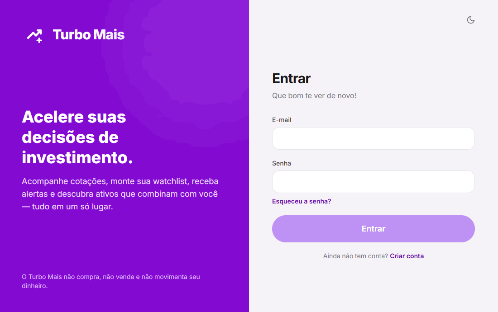
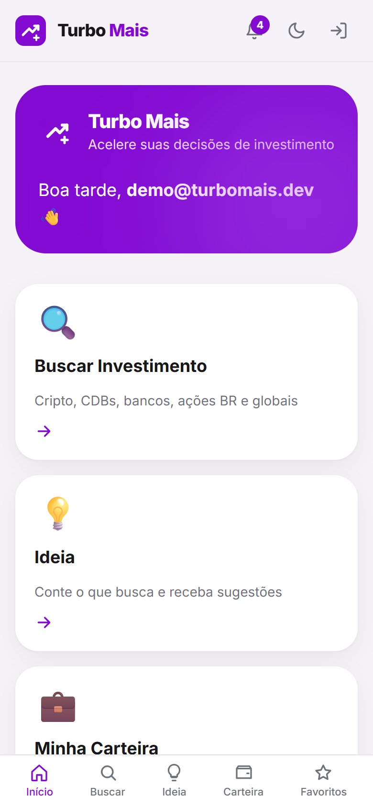
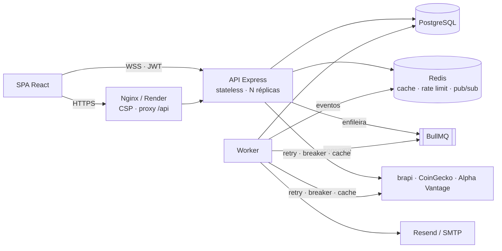

<div align="center">


# Turbo Mais

**Acelere suas decisões de investimento**

Painel pessoal de consulta, watchlist, alertas em tempo real e sugestões personalizadas de investimentos — com Clean Architecture, resiliência a falhas, segurança OWASP e decisões documentadas.

[](frontend)
[](backend)
[](database)
[](docs/adr/ADR-003-redis-cache.md)
[](docker-compose.yml)
[](docs/SECURITY.md)
[](.github/workflows/ci.yml)
[](.github/workflows/security.yml)
[](LICENSE)

[**🚀 Demo ao vivo**](https://turbo-mais.onrender.com) · [**📘 Swagger**](https://turbo-mais-api.onrender.com/api/docs) · [**🏛️ Arquitetura**](docs/ARCHITECTURE.md) · [**📝 ADRs**](docs/adr) · [**🔐 Segurança**](docs/SECURITY.md)

</div>

> ⚠️ **O Turbo Mais NÃO compra, NÃO vende e NÃO movimenta dinheiro.** É um painel de consulta. Você acompanha tudo aqui e opera na sua corretora (Nubank, XP, Rico…). Conteúdo educativo, não é recomendação de investimento.

---

## 🎬 Demonstração

<!-- Grave com ScreenToGif/Kap: login → buscar → favoritar → alerta → notificação. Salve em docs/assets/ -->
| Fluxo principal (login → buscar → favoritar → notificação) | Mobile |
|---|---|
|  |  |

**Experimente localmente:** `docker compose up --build` → http://localhost:8080 · login `demo@turbomais.dev` / `Demo@12345`

---

## 🎯 O problema

Quem começa a investir alterna entre o app da corretora, sites de cotação, planilhas e grupos de mensagem — e mesmo assim não entende **o que** a empresa faz nem **por que** um ativo combinaria com seus objetivos. O Turbo Mais junta num só lugar:

- 🔍 **Busca por categoria** — Cripto, CDBs, Bancos, Ações BR e Ações Globais, com preço e variação.
- 📖 **Página educativa** de cada ativo — "o que essa empresa faz", "papel na sociedade", indicadores com tooltips em linguagem simples e gráfico histórico.
- ⭐ **Watchlist** com cotações em tempo real (WebSocket).
- 🔔 **Alertas de variação** com notificação no app e no navegador.
- 💡 **Ideia** — descreva seus objetivos em texto livre e receba o top 10 de ativos compatíveis, cada um com "por que combina com você".
- 💼 **Minha Carteira** — visão de acompanhamento por categoria (sem valores investidos, lucro ou prejuízo — por decisão de produto).
- 🌗 Dark mode, 🔐 2FA por e-mail, 📱 layout mobile-first.

---

## 🧱 Stack

| Camada | Tecnologias |
|---|---|
| **Frontend** | React 18, React Router, Tailwind CSS, Recharts, Socket.IO client, Vite |
| **Backend** | Node.js 22, Express 5, Clean Architecture, DI manual, Zod |
| **Dados** | PostgreSQL 16 (SQL puro com `pg`), Prisma **só para migrations** |
| **Cache / filas / tempo real** | Redis, BullMQ (com DLQ), Socket.IO + Redis adapter |
| **Resiliência** | p-retry (backoff + jitter), opossum (circuit breaker), cache stale-while-revalidate |
| **Segurança** | JWT access + refresh com rotação e detecção de reuso, bcrypt, 2FA por e-mail, Helmet + CSP, CSRF double-submit, rate limit em Redis |
| **Observabilidade** | Pino (JSON com redação), Request ID, Prometheus (`/metrics`), `/live` `/ready` `/health` |
| **E-mail** | Resend → Nodemailer (fallback) |
| **Testes** | Jest, Supertest, React Testing Library, testes de contrato, k6 |
| **Infra** | Docker multi-stage, docker compose, GitHub Actions, Render + Neon + Upstash |
| **Segurança no CI** | npm audit, Snyk, Trivy, CodeQL, Dependency Review, Dependabot |

---

## 🏛️ Arquitetura



```
backend/src
├── domain/          entidades, value objects, motor de sugestões, interfaces  ← zero dependências
├── application/     casos de uso, portas, DTOs (Zod), erros
├── infrastructure/  Postgres, Redis, BullMQ, APIs externas, resiliência, segurança, e-mail, WebSocket, logs, métricas
├── interfaces/      HTTP: rotas, controllers finos, middlewares, presenters
└── config/          env (fail fast), container (composition root), swagger
```

Detalhes, diagramas de sequência e modelo de dados: **[docs/ARCHITECTURE.md](docs/ARCHITECTURE.md)**.

---

## 🧠 Decisões e trade-offs (resumo)

Cada decisão tem uma ADR com contexto, alternativas e consequências — [docs/adr](docs/adr).

| # | Decisão | Trade-off aceito |
|---|---|---|
| [001](docs/adr/ADR-001-sql-puro-vs-orm.md) | SQL puro; Prisma só para migrations | Mapeamento manual de linhas, em troca de controle total (`ON CONFLICT`, `FOR UPDATE`, `UNNEST`, índices parciais) |
| [002](docs/adr/ADR-002-clean-architecture.md) | Clean Architecture com DI manual | Mais arquivos; regras testáveis sem I/O |
| [003](docs/adr/ADR-003-redis-cache.md) | Cache SWR + último valor conhecido | Usuário pode ver preço de alguns minutos — sinalizado na UI |
| [004](docs/adr/ADR-004-bullmq-vs-cron.md) | BullMQ em vez de cron | Redis vira dependência crítica dos workers |
| [005](docs/adr/ADR-005-websocket-fallback-polling.md) | WebSocket → long-polling → REST | Mais estados no cliente |
| [006](docs/adr/ADR-006-api-versionamento.md) | `/api/v1` + envelope único + `error.code` | Duplicação temporária quando vier a v2 |
| [007](docs/adr/ADR-007-falha-apis-externas.md) | Breaker(retry(fetch + contrato Zod)) + fallback | Ativo "indisponível" por até 30 s após a API voltar |
| [008](docs/adr/ADR-008-idempotencia-notificacoes.md) | Idempotência pelo banco (`UNIQUE` + `ON CONFLICT`) + `Idempotency-Key` | Janela fixa pode gerar 2 avisos na virada da hora |
| [009](docs/adr/ADR-009-escalabilidade-horizontal.md) | API stateless, estado no Redis | Rate limit/bloqueio fail-open se o Redis cair |
| [010](docs/adr/ADR-010-estrategia-rollback.md) | Rollback automático + migrations expand/contract | Mudanças de schema grandes levam vários deploys |

**O que acontece quando algo falha?**

| Falha | Comportamento |
|---|---|
| API de mercado fora/lenta | cache stale → último valor conhecido ("desatualizado") → "indisponível"; breaker evita cascata; alertas **não** disparam com dado velho |
| Provedor de e-mail fora | Resend → SMTP; job com 3 retries e backoff; esgotou → **DLQ** + métrica |
| Redis fora | cache vira pass-through; rate limit e bloqueio fail-open; `/ready` = 503 (LB tira a réplica) |
| WebSocket bloqueado | long-polling após 3 falhas; polling REST após 6; status no header |
| Worker reprocessa job | `hash_idempotencia UNIQUE` impede notificação duplicada |
| Deploy quebrado | healthcheck falha → rollback automático em ~2–3 min |
| Refresh token roubado | reuso detectado → família de sessões revogada + audit log |

---

## 🚀 Como rodar

### Com Docker (1 comando)

```bash
git clone https://github.com/SEU-USUARIO/turbo-mais.git && cd turbo-mais
docker compose up --build
```

| URL | O quê |
|---|---|
| http://localhost:8080 | App (login `demo@turbomais.dev` / `Demo@12345`) |
| http://localhost:3333/api/docs | Swagger |
| http://localhost:3333/health | Saúde das dependências |
| http://localhost:8025 | Mailpit — veja os e-mails de reset de senha e códigos 2FA |

Por padrão os preços são **simulados** (sem chaves). Para dados reais: copie `.env.example` → `.env`, defina `MARKET_DATA_MODE=live` e as chaves.

### Localmente (sem Docker para o código)

Pré-requisitos: Node 22, Postgres 16 e Redis 7 (ex.: `docker compose up postgres redis mailpit`).

```bash
# API
cd backend
cp .env.example .env           # ajuste DATABASE_URL/REDIS_URL se preciso
npm install
npm run db:setup               # migrations (Prisma) + seeds
npm run dev                    # API em :3333
npm run dev:worker             # em outro terminal: workers

# Frontend
cd ../frontend
npm install
npm run dev                    # http://localhost:5173 (proxy para a API)
```

### Variáveis de ambiente

Todas documentadas e validadas na inicialização (a API não sobe com configuração inválida):
[`backend/.env.example`](backend/.env.example) · [`frontend/.env.example`](frontend/.env.example) · [`.env.example`](.env.example) (compose).

Principais: `DATABASE_URL`, `REDIS_URL`, `JWT_ACCESS_SECRET`/`JWT_RESET_SECRET`/`JWT_2FA_SECRET`/`CODE_HMAC_SECRET` (≥ 32 chars, um por finalidade), `CORS_ORIGINS`, `COOKIE_SECURE`, `MARKET_DATA_MODE`, `RESEND_API_KEY`.

---

## 📡 Endpoints principais

Base: `/api/v1` · Envelope: `{ success, data, error, meta }` · Docs completas: **`/api/docs`**

| Método | Rota | Descrição | Rate limit |
|---|---|---|---|
| POST | `/auth/cadastro` | e-mail, celular, senha | 10/15 min/IP |
| POST | `/auth/login` | sessão ou desafio 2FA | 10/15 min/IP |
| POST | `/auth/refresh` · `/auth/logout` | cookie httpOnly + CSRF | global |
| POST | `/auth/esqueci-senha` · `/auth/resetar-senha` | recuperação (fila + token de uso único) | 5/h/IP |
| POST | `/auth/2fa/ativar` · `/auth/2fa/validar` | verificação em duas etapas | — |
| GET | `/ativos` · `/ativos/{acoes-brasileiras,acoes-globais,criptomoedas,cdbs,bancos}` | listas com cotação | 120/min/usuário |
| GET | `/ativos/:ticker` | detalhe educativo + histórico + indicadores | 120/min/usuário |
| GET/POST/DELETE | `/favoritos` | watchlist (POST idempotente) | 120/min/usuário |
| GET/POST/PUT/DELETE | `/alertas` | alertas de variação | 120/min/usuário |
| GET · PATCH | `/notificacoes` · `/notificacoes/:id/lida` | histórico | 120/min/usuário |
| POST/GET | `/ideias` | sugestões personalizadas | 120/min/usuário |
| GET | `/live` · `/ready` · `/health` · `/metrics` | operação | — |

---

## 🧪 Testes

```bash
cd backend
npm run test:unit         # 216 testes, cobertura do núcleo ~97% (mínimo exigido: 80%)
npm run test:contract     # contratos das APIs externas (fixtures); CONTRACT_LIVE=true bate nas APIs reais
npm run test:integration  # HTTP + Postgres + Redis reais (precisa dos serviços de pé)
npm run test:e2e          # jornada: cadastro → login → favoritar → alerta → notificação → ideia → logout
npm run test:load         # k6: rampa até 1000 usuários simultâneos (p95 < 500 ms, erro < 1%)

cd ../frontend
npm test                  # React Testing Library + testes do cliente HTTP e do fallback do socket
```

**Teste de carga:** rode a API com `MARKET_DATA_MODE=mock` (mede a nossa capacidade, não a das APIs externas) e `RATE_LIMIT_ENABLED=false` (todos os usuários virtuais saem do mesmo IP). Os thresholds do k6 são o SLO: se forem violados, o comando sai com erro.

| Camada | O que garante |
|---|---|
| Unitários | regras de domínio, casos de uso (com fakes), cache SWR, retry/breaker, segurança de tokens, middlewares |
| Contrato | parsers das APIs externas; mudança de formato quebra o CI antes do usuário |
| Integração | SQL real, constraints, cookies/CSRF, rotação de tokens, IDOR, idempotência, métricas |
| E2E | o fluxo do usuário inteiro pela API |
| Carga | capacidade e SLO com 1000 usuários |

---

## 🔁 CI/CD

| Workflow | Quando | O que faz |
|---|---|---|
| [`ci.yml`](.github/workflows/ci.yml) | todo PR para `main` | lint · unitários (≥ 80%) · contrato · integração + E2E com Postgres/Redis · migrations do zero + seeds 2× · build · `npm audit` · build das imagens · consistência front/back |
| [`security.yml`](.github/workflows/security.yml) | todo PR + semanal | Snyk · Trivy · CodeQL · Dependency Review · npm audit |
| [`cd.yml`](.github/workflows/cd.yml) | merge na `main` | CI → migrations no Neon → deploy da API → healthcheck → **rollback automático** → front → smoke test |
| Dependabot | semanal | PRs agrupados de npm, Docker e Actions |

Passo a passo de deploy (Render + Neon + Upstash, secrets, branch protection, rollback): **[docs/DEPLOY.md](docs/DEPLOY.md)**.

---

## 🔐 Segurança

Resumo do que está implementado (detalhes em [SECURITY.md](docs/SECURITY.md) e [THREAT-MODEL.md](docs/threat-model/THREAT-MODEL.md) — análise STRIDE):

access token só em memória · refresh opaco em cookie httpOnly/SameSite=Strict com rotação e detecção de reuso · bcrypt 12 · bloqueio após 5 falhas · 2FA por e-mail (HMAC, 5 tentativas) · reset com token de uso único no fragmento da URL · SQL 100% parametrizado · Zod `.strict()` · sanitização XSS · CSP sem `unsafe-inline` · CORS por whitelist · CSRF double-submit (`__Host-`) · rate limit por IP e por usuário · audit log · logs com redação · stack trace nunca exposto · contêineres não-root · scans automáticos no CI.

---

## 🔭 O que eu faria diferente com mais tempo

- **TypeScript** de ponta a ponta, com tipos gerados do OpenAPI para o front.
- **OpenTelemetry** (traces distribuídos API → fila → worker → APIs externas) em vez de só correlação por Request ID; dashboards Grafana e alertas sobre os SLOs.
- **Provedor de dados de mercado pago** com SLA e streaming, em vez de três APIs gratuitas com cotas.
- **Motor de sugestões com embeddings** (busca semântica) mantendo a explicabilidade do "por que combina com você"; hoje é baseado em regras e dicionário — determinístico e auditável, mas limitado a sinônimos conhecidos.
- **Confirmação de e-mail no cadastro**, eliminando a enumeração de contas pelo 409.
- **WebAuthn/passkeys ou TOTP** no lugar do 2FA por e-mail.
- **Janela deslizante** de deduplicação de alertas (intervalo mínimo por alerta) em vez de baldes fixos de 1 hora.
- **Testes E2E no navegador** (Playwright) além dos E2E de API, e testes de mutação no domínio.
- **Canary deploy** e feature flags.

## 🗺️ Roadmap

- [ ] Web Push (alertas com o app fechado) via Service Worker
- [ ] App mobile (React Native) consumindo a mesma API v1
- [ ] Alertas por preço-alvo (além de variação %)
- [ ] Comparador lado a lado de ativos
- [ ] FIIs, Tesouro Direto e ETFs no catálogo
- [ ] Exclusão de conta self-service e exportação de dados (LGPD)
- [ ] Particionamento do priceWatcher por lote de tickers

---

## 👤 Autor

**Agnaldo Teixeira** — Desenvolvedor Full Stack

- 💼 LinkedIn: [linkedin.com/in/SEU-PERFIL](https://linkedin.com/in/SEU-PERFIL)
- 🐙 GitHub: [@SEU-USUARIO](https://github.com/SEU-USUARIO)
- ✉️ agnaldoteixeira338@gmail.com

## 📄 Licença

Distribuído sob a licença MIT. Veja [LICENSE](LICENSE).
