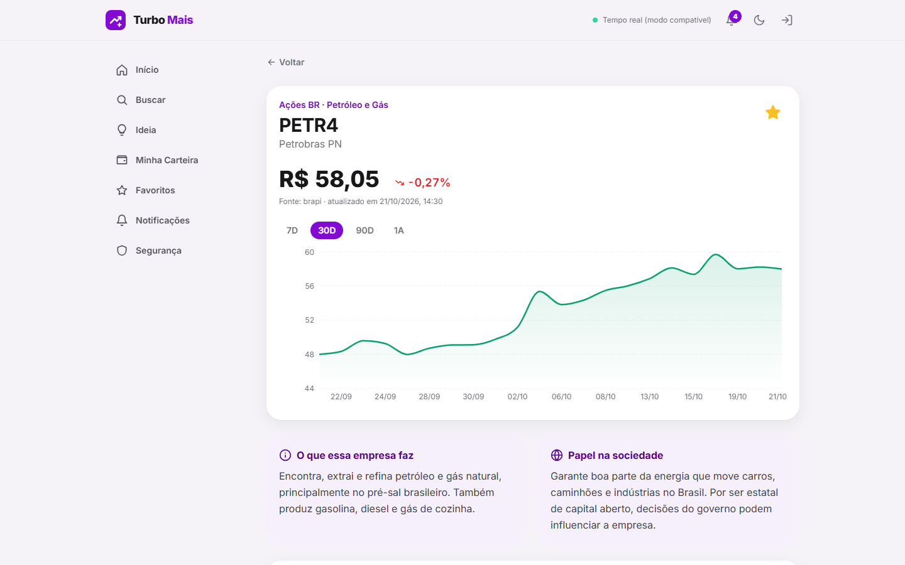
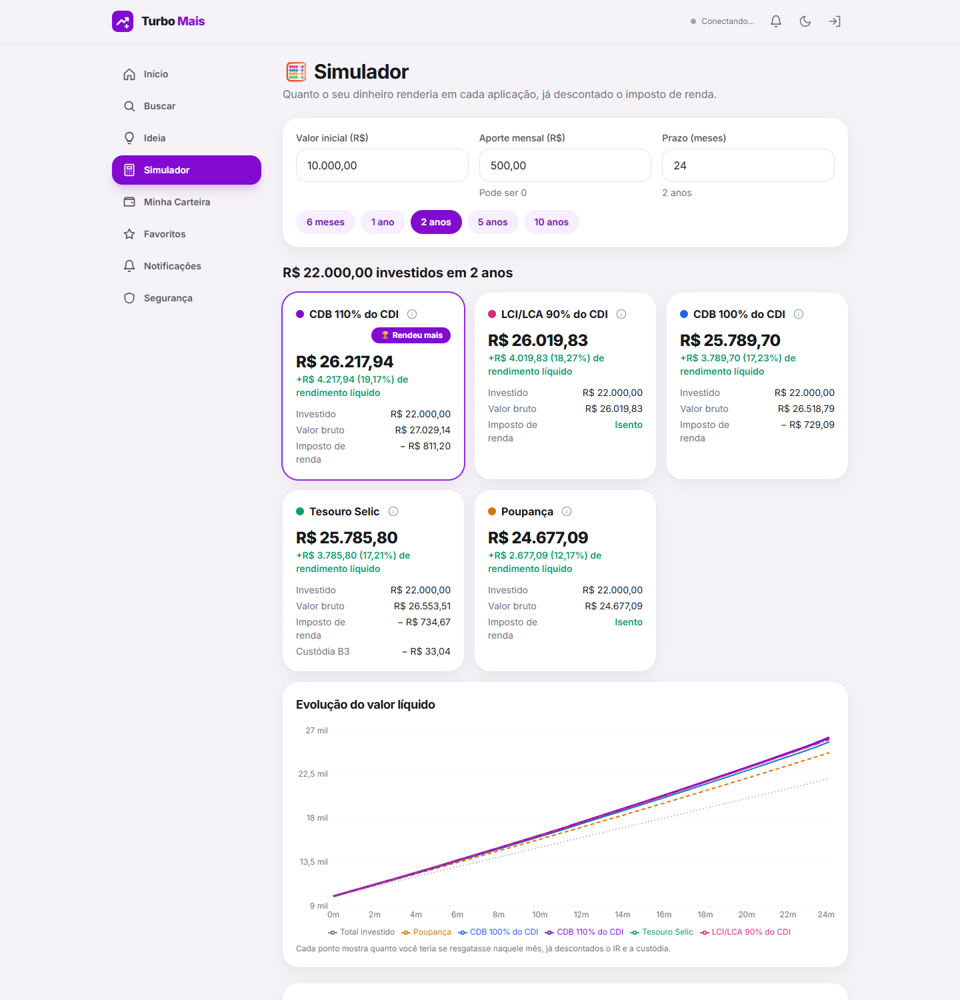
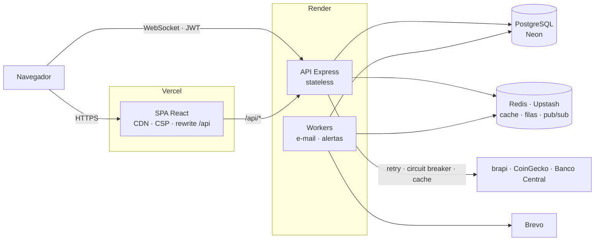

<div align="center">


# Turbo Mais

**Painel de investimentos com cotações reais, alertas em tempo real e sugestões personalizadas.**

[](.github/workflows/ci.yml)
[](.github/workflows/cd.yml)
[](.github/workflows/security.yml)
[](frontend)
[](backend)
[](database)
[](LICENSE)
[](https://www.linkedin.com/in/agnaldo-teixeira-damacena)

### [🚀 Abrir a demo](https://turbo-mais.vercel.app) · [📘 API (Swagger)](https://turbo-mais-api.onrender.com/api/docs) · [🏛️ Arquitetura](docs/ARCHITECTURE.md) · [📝 Decisões (ADRs)](docs/adr)

**Sem cadastro:** clique em **"Entrar como visitante"** na tela de login.

</div>

> ⏳ A API roda no plano gratuito da Render, que "dorme" após 15 min sem uso. Ao abrir o site, ela já começa a acordar em segundo plano; se ainda estiver acordando quando você clicar, o app avisa *"Acordando o servidor"*. O primeiro acesso pode levar até 1 minuto.

---

## ⚡ Em 30 segundos

- **O que é:** um painel onde a pessoa acompanha ações brasileiras, ações americanas (via BDR), criptomoedas e CDBs, entende o que cada empresa faz em linguagem simples, cria alertas de variação, recebe sugestões a partir de um texto livre e **simula quanto o dinheiro renderia** na poupança, em CDBs, no Tesouro Selic e em LCI/LCA, com as taxas do Banco Central e já descontado o imposto. **Não compra nem vende nada**: é para consulta, quem opera é a corretora do usuário.
- **No ar, com dados reais:** frontend na Vercel, API na Render, PostgreSQL no Neon e Redis no Upstash, com **deploy automático e rollback** a cada merge.
- **Engenharia:** Clean Architecture, **270+ testes automatizados** (unitários, integração, E2E, contrato e carga), autenticação com JWT + refresh token rotativo + 2FA por e-mail, cache com *stale-while-revalidate*, filas com retry e *dead letter queue*, circuit breaker e WebSocket com fallback.
- **Decisões documentadas:** [uma ADR por decisão](docs/adr) explica o porquê de cada escolha, incluindo **problemas reais de produção diagnosticados e resolvidos** ([veja abaixo](#-problemas-reais-de-produção)).
- **Feito com IA, com transparência:** construído em par com o Claude Code. [Explico como e qual foi o meu papel](#-como-este-projeto-foi-construído).

---

## 🎬 Demonstração

| Fluxo: login → busca → favoritar → detalhe educativo → ideia → dark mode | Celular |
|---|---|
|  |  |



**Simulador:** R$ 10 mil + R$ 500 por mês durante 2 anos, com as taxas do Banco Central do dia e o imposto já descontado.



<sub>Capturas geradas automaticamente do site em produção (Edge headless + Puppeteer), com cotações reais.</sub>

---

## ✨ O que o app faz

| Tela | O que tem |
|---|---|
| 🔍 **Buscar investimento** | Abas de Ações BR, Ações Globais (BDRs), Cripto, CDBs e Bancos, com preço e variação do dia |
| 📖 **Detalhe do ativo** | "O que a empresa faz", "papel na sociedade", gráfico histórico, P/L, dividend yield e valor de mercado, com glossário em tooltips |
| ⭐ **Favoritos** | Watchlist com cotações atualizadas em tempo real (WebSocket) |
| 🔔 **Alertas e notificações** | "Me avise se PETR4 cair 3%": notificação no app e no navegador, sem duplicar |
| 💡 **Ideia** | O usuário descreve o que busca ("renda passiva com pouco risco") e recebe o top 10 de ativos, cada um com o motivo |
| 🧮 **Simulador** | "Se eu aplicar R$ 10 mil + R$ 500 por mês durante 2 anos?": poupança, CDB 100% e 110% do CDI, Tesouro Selic e LCI/LCA lado a lado, com IR regressivo por aporte, custódia do Tesouro, gráfico da evolução e taxas reais do Banco Central ([ADR-014](docs/adr/ADR-014-simulador-de-investimentos.md)) |
| 💼 **Minha Carteira** | Visão por categoria do mercado e dos favoritos (sem valores investidos, por decisão de produto) |
| 🔐 **Conta e segurança** | Cadastro sem CPF, recuperação de senha por e-mail, 2FA por código, bloqueio após 5 tentativas, dark mode |

---

## 🧯 Problemas reais de produção

Colocar no ar revelou problemas que não aparecem em ambiente local. Cada um foi diagnosticado, corrigido, testado e documentado:

| Problema | Causa encontrada | Solução |
|---|---|---|
| As 7 ações americanas apareciam como "indisponível" | A Alpha Vantage gratuita limita **por IP**, e o IP compartilhado da Render já chegava sem cota (além do limite de 1 requisição/s) | Fila espaçada por provedor e troca da fonte para **BDRs na B3 via brapi**, mantendo a Alpha Vantage como reserva ([ADR-012](docs/adr/ADR-012-acoes-globais-via-bdr.md)) |
| O tempo real caía para o "modo compatível" | A Vercel marca variáveis novas como *Sensitive*, e o build do CD recebia o texto `sensitive` no lugar da URL do WebSocket | Configuração pública do build versionada no repositório; diagnosticado com o navegador em modo headless ([ADR-011](docs/adr/ADR-011-hospedagem-vercel-render.md)) |
| API não subia no primeiro deploy | URL do Redis colada com aspas no painel, e a senha aparecia no log de erro | Validação que remove aspas, erro claro na inicialização e **máscara de credenciais nos logs** |
| E-mails não saíam pelo Gmail | A Render gratuita **bloqueia SMTP** desde set/2025 | Provedor por API HTTP (Brevo), com fallback entre provedores |
| 20 alertas de segurança ao ativar o Dependabot | Versões vulneráveis do nodemailer e do react-router em produção | Atualização com testes, override pontual para não quebrar o Tailwind e política documentada ([SECURITY.md](docs/SECURITY.md)) |

---

## 🏛️ Arquitetura



O backend segue **Clean Architecture**: as regras de negócio (domínio e casos de uso) não dependem de banco, Redis ou APIs externas. Por isso são testadas em milissegundos e permitem trocar peças (como aconteceu com a fonte das ações americanas) sem mexer no domínio.

```
backend/src
├── domain/          entidades, value objects, motor de sugestões   ← sem dependências
├── application/     casos de uso, portas, validação (Zod), erros
├── infrastructure/  Postgres, Redis, BullMQ, APIs externas, e-mail, WebSocket, logs, métricas
└── interfaces/      HTTP: rotas, controllers, middlewares de segurança
```

Detalhes e diagramas de sequência: **[docs/ARCHITECTURE.md](docs/ARCHITECTURE.md)**.

---

## 🧱 Stack

| Camada | Tecnologias |
|---|---|
| **Frontend** | React 18, React Router 7, Tailwind CSS, Recharts, Socket.IO client, Vite |
| **Backend** | Node.js 22, Express 5, Zod, Pino, prom-client |
| **Dados** | PostgreSQL (SQL puro com `pg`; Prisma só para migrations), Redis |
| **Assíncrono e tempo real** | BullMQ (retry + DLQ), Socket.IO com Redis adapter |
| **Resiliência** | p-retry (backoff + jitter), opossum (circuit breaker), cache stale-while-revalidate |
| **Segurança** | JWT + refresh token rotativo com detecção de reuso, bcrypt, 2FA, CSP, CSRF, rate limit, audit log |
| **Testes** | Jest, Supertest, React Testing Library, testes de contrato, k6 (carga) |
| **Infra e entrega** | Docker, GitHub Actions, Vercel, Render, Neon, Upstash, Dependabot, CodeQL, Trivy |

---

## 🤖 Como este projeto foi construído

Este projeto foi desenvolvido **em par com uma IA (Claude Code)**, e prefiro deixar isso claro: por isso os commits trazem `Co-Authored-By: Claude`.

**O que eu fiz:**
- Defini o produto e os requisitos: o que o app faz, o que ele não faz (não movimentar dinheiro) e o nível de qualidade esperado (testes, segurança, observabilidade, decisões documentadas).
- Tomei as decisões quando havia escolha: hospedar o frontend na Vercel e o backend na Render, usar BDRs para as ações americanas, usar a Brevo para os e-mails.
- Criei e configurei toda a infraestrutura: Neon, Upstash, Render, Vercel, Brevo, chaves das APIs de mercado e os secrets do deploy automático.
- Testei o app no ar e acompanhei o diagnóstico de cada problema de produção da tabela acima, até a correção.

**O que a IA fez:** escreveu a maior parte do código, dos testes e da documentação, sempre validados por testes automatizados e no ambiente real.

**Como uso o projeto para aprender:** os [ADRs](docs/adr) e o [ARCHITECTURE.md](docs/ARCHITECTURE.md) são o meu material de estudo. O objetivo é conseguir explicar, com minhas palavras, cada decisão: por que cache *stale-while-revalidate*, como funciona a rotação de refresh token, por que garantir a idempotência no banco e não na fila.

---

## 🚀 Como rodar

**Com Docker (um comando):**

```bash
git clone https://github.com/agnaldoteixeira338-code/turbo-mais.git && cd turbo-mais
docker compose up --build
```

Abra http://localhost:8080 e entre com `demo@turbomais.dev` / `Demo@12345`. Os preços vêm do modo simulado (sem chaves de API); os e-mails de teste aparecem no Mailpit, em http://localhost:8025.

**Sem Docker para o código** (precisa de Postgres e Redis rodando): instruções e variáveis em [`backend/.env.example`](backend/.env.example) e [`frontend/.env.example`](frontend/.env.example). Para publicar a sua própria cópia: [docs/DEPLOY.md](docs/DEPLOY.md).

---

## 🧪 Qualidade

| | |
|---|---|
| **Testes** | 240+ no backend (cobertura de ~97% nas regras de negócio) e 38 no frontend. Integração e E2E rodam com PostgreSQL e Redis reais no CI. Contrato das APIs externas verificado diariamente contra as APIs reais |
| **CI** | Lint, testes, build, imagens Docker e auditoria de dependências em todo pull request |
| **Segurança** | CodeQL, Trivy nas imagens, revisão de dependências, Dependabot, secret scanning e push protection. **Produção com 0 vulnerabilidades conhecidas** |
| **Entrega** | `main` protegida (pull request + CI verde). Cada merge publica sozinho: migrations → API → frontend → teste ponta a ponta, com **rollback automático** se algo falhar |
| **Observabilidade** | Logs estruturados com Request ID e dados sensíveis mascarados; `/health`, `/ready` e `/metrics` (Prometheus) |

```bash
cd backend && npm run test:unit      # unitários + cobertura
cd frontend && npm test              # React Testing Library
```

---

## ⚖️ Limitações conhecidas

- **Plano gratuito:** a API "dorme" sem uso (mitigado: o site a acorda ao abrir e avisa enquanto ela responde) e os workers rodam dentro do processo da API.
- **Conta de visitante compartilhada:** todos os visitantes usam a mesma conta demo, então favoritos e alertas criados nela ficam visíveis para os próximos.
- **Ações americanas** são cotadas pelo BDR na B3, em reais, e não pela ação original em dólares ([ADR-012](docs/adr/ADR-012-acoes-globais-via-bdr.md)).
- **E-mails** saem pelo plano gratuito da Brevo, sem domínio próprio, e podem cair no spam.
- **CDBs** do catálogo são exemplos didáticos, não ofertas reais.

## 🔭 Próximos passos

- [ ] TypeScript de ponta a ponta
- [ ] Testes E2E no navegador (Playwright)
- [ ] App autenticador (TOTP) e códigos de recuperação, além do 2FA por e-mail
- [ ] Web Push para alertas com o app fechado
- [ ] Tracing distribuído (OpenTelemetry)

---

## 👤 Autor

**Agnaldo Teixeira** — estudante de Análise e Desenvolvimento de Sistemas (UNINOVE), buscando **estágio em desenvolvimento em São Paulo**.

- 💼 LinkedIn: [agnaldo-teixeira-damacena](https://www.linkedin.com/in/agnaldo-teixeira-damacena)
- 🐙 GitHub: [@agnaldoteixeira338-code](https://github.com/agnaldoteixeira338-code)
- ✉️ agnaldoteixeira338@gmail.com

<sub>Conteúdo educativo, não é recomendação de investimento. Licença [MIT](LICENSE).</sub>
