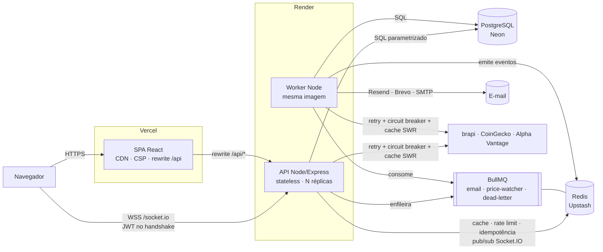
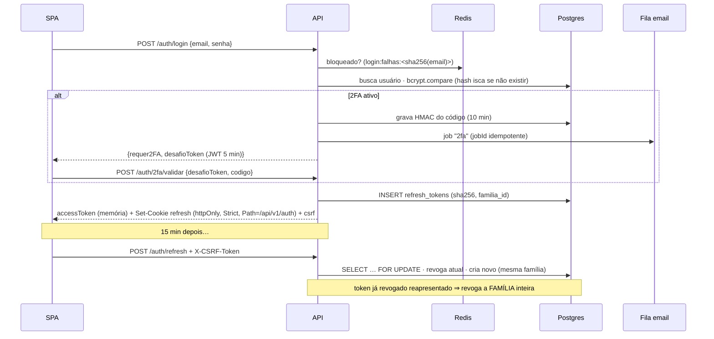
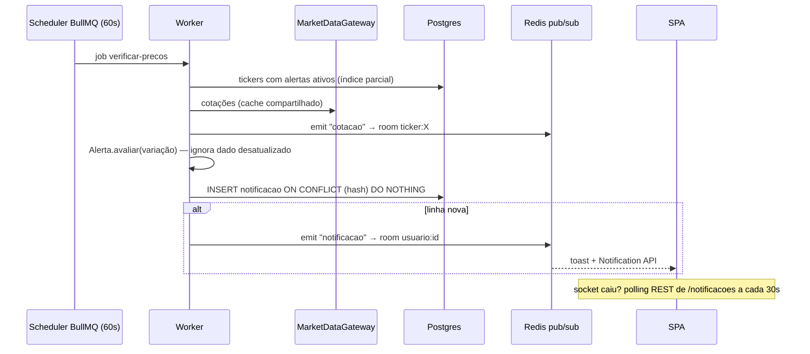
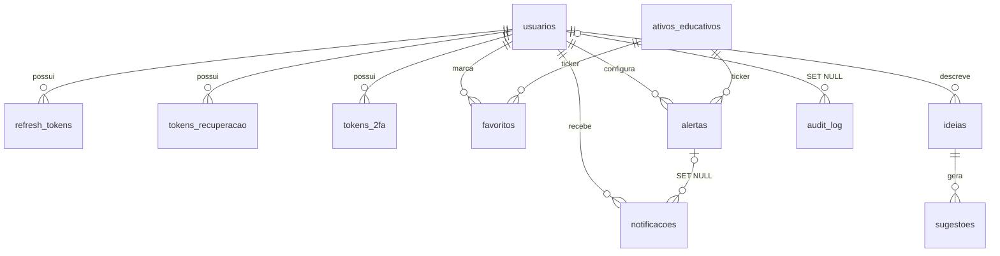

# Arquitetura do Turbo Mais

> Painel de consulta e monitoramento de mercado. **Não compra, não vende, não move dinheiro.**

## 1. Visão de contêineres



| Contêiner | Hospedagem | Responsabilidade | Escala |
|---|---|---|---|
| SPA (React + Tailwind) | **Vercel** | UI, sessão em memória, degradação do tempo real; rewrite `/api` → Render | CDN global |
| API (Express) | **Render** | HTTP v1, Socket.IO, auth, validação, cache | horizontal (stateless) — ADR-009 |
| Worker | **Render** | e-mails, priceWatcher (60 s), DLQ | independente da API — ADR-004 |
| PostgreSQL | **Neon** | fonte da verdade (11 tabelas) | vertical + pooler |
| Redis | **Upstash** | cache SWR, rate limit, bloqueio de login, idempotência, filas, pub/sub | vertical |

Por que o front e o back estão em plataformas diferentes: [ADR-011](adr/ADR-011-hospedagem-vercel-render.md). Localmente, o `docker compose` substitui a Vercel por um Nginx com a mesma CSP e o mesmo proxy de `/api`.

## 2. Camadas do backend (Clean Architecture)

```
src/
├── domain/            ← regras puras, zero dependências
│   ├── entities/        Usuario, Alerta (avaliar), Notificacao (hash), AtivoEducativo, Ideia, Sugestao, Favorito
│   ├── value-objects/   Email, Celular (E.164), Senha (política + ≤72 bytes), Ticker
│   ├── services/        MotorDeSugestoes + dicionarioSinonimos.json
│   └── repositories/    interfaces (contratos)
├── application/       ← casos de uso, um por arquivo
│   ├── use-cases/       auth · favoritos · alertas · notificacoes · ativos · ideias
│   ├── ports/           PasswordHasher, TokenService, EmailQueue, MarketDataGateway, Notificador, UnitOfWork…
│   ├── dtos/            schemas Zod (contrato de entrada)
│   └── errors/          AppError → 400/401/403/404/409/422/429/503
├── infrastructure/    ← adaptadores
│   ├── database/        pool, UnitOfWork, repositórios PostgreSQL
│   ├── cache/           Redis + CacheService (SWR)
│   ├── queue/           filas, DLQ, workers
│   ├── external-apis/   brapi, coingecko, alphaVantage, simulado, MarketDataGateway
│   ├── resilience/      retryPolicy (p-retry), circuitBreakers (opossum)
│   ├── security/        bcrypt, JWT, bloqueio de login, audit log
│   ├── email/           Resend → Brevo → Nodemailer → console(dev)
│   ├── websocket/       servidor Socket.IO + emitter
│   ├── logger/          Pino com redação
│   └── observability/   métricas Prometheus
├── interfaces/        ← HTTP
│   ├── http/            app, rotas, controllers finos, middlewares
│   └── presenters/      whitelist do que sai na API
├── config/            env (fail fast), container (composition root), swagger
├── shared/            utils, sanitização, idempotência, contexto de requisição
├── server.js          processo da API
└── worker.js          processo dos workers
```

Regra de dependência: `interfaces → application → domain`; `infrastructure` implementa portas. O único arquivo que conhece tudo é `config/container.js`.

## 3. Fluxos de dados

### 3.1 Login com 2FA e rotação de refresh token



### 3.2 Cotação (leitura)

`Controller → BuscarAtivos → MarketDataGateway → CacheService (fresco | stale+revalida | origem) → breaker(retry(fetch + Zod)) → lkg → indisponível`. Detalhes na [ADR-007](adr/ADR-007-falha-apis-externas.md).

### 3.3 Alerta → notificação



### 3.4 Ideia → sugestões

Texto → `sanitizarTexto` (XSS) → `MotorDeSugestoes` (normaliza, casa conceitos do dicionário por palavra inteira, pontua tipo/setor/tag/perfil/país, penaliza perfis evitados) → top 10 com justificativa → `ideias` + `sugestoes` na **mesma transação**.

## 4. Modelo de dados



Destaques: `UNIQUE(lower(email))`; `notificacoes.hash_idempotencia UNIQUE`; índices parciais `alertas(ticker) WHERE ativo` e `notificacoes(usuario_id) WHERE NOT lida`; tokens guardados só como hash; `audit_log` sobrevive à exclusão da conta.

## 5. Observabilidade

| Sinal | Onde |
|---|---|
| Logs JSON (Pino) | stdout; `requestId`, `usuarioId`, `jobId` via AsyncLocalStorage; senhas/tokens/códigos/celular redigidos e e-mails mascarados |
| Correlação | header `X-Request-Id` (aceito do proxy ou gerado) → logs → `error.requestId` na resposta → `audit_log.request_id` → dados do job |
| Métricas | `GET /metrics` — duração/volume por rota, erros por código, cache hit/stale/miss, jobs por fila (inclui DLQ), estado dos circuit breakers, conexões WS, duração do priceWatcher |
| Saúde | `/live` (processo) · `/ready` (Postgres+Redis, 503 em shutdown) · `/health` (diagnóstico com filas e breakers) |

## 6. Frontend

- **Estado**: contexts `Auth → Socket → Favoritos / Notificações` + `Theme`.
- **Sessão**: access token só em memória; refresh por cookie httpOnly ao abrir o app; refresh *single-flight* em 401.
- **Tempo real**: WebSocket → long-polling (3 falhas) → REST (6 falhas); status visível no header.
- **Performance**: rotas com `lazy()`; Recharts em chunk próprio; `AbortController` cancela buscas obsoletas.
- **Acessibilidade**: labels, `aria-pressed`, `aria-live` nos toasts, cor nunca é o único sinal de alta/queda, foco visível, "pular para o conteúdo".
