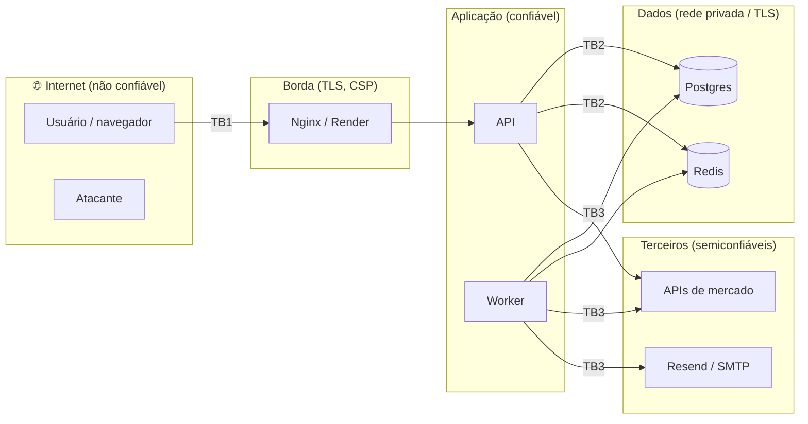

# Threat Model — STRIDE

- **Versão:** 1.0 (2026-09)
- **Método:** STRIDE por elemento do diagrama de fluxo de dados, com risco = probabilidade × impacto (B/M/A).

## 1. Fronteiras de confiança

- **TB1** navegador ↔ borda: toda entrada é hostil.
- **TB2** aplicação ↔ dados: credenciais em variáveis de ambiente; TLS no Neon/Upstash.
- **TB3** aplicação ↔ terceiros: respostas são validadas por contrato (Zod) — terceiro também é entrada não confiável.

## 2. Ativos

| Ativo | Por que importa |
|---|---|
| Credenciais (senha, sessão) | tomada de conta |
| E-mail e celular | dado pessoal (LGPD) |
| Watchlist, alertas, ideias | privacidade de interesses financeiros |
| Integridade das notificações | alerta falso pode induzir decisão ruim |
| Disponibilidade | painel inútil se fora do ar |
| Cota das APIs externas | esgotar a cota = DoS indireto |

## 3. Análise STRIDE

### S — Spoofing (falsificação de identidade)

| Ameaça | Risco | Mitigação | Residual |
|---|---|---|---|
| Força bruta / credential stuffing no login | A | bcrypt 12; bloqueio de conta após 5 falhas; rate limit 10/15 min por IP; 2FA opcional | Ataque distribuído lento ainda possível → 2FA |
| Roubo de refresh token (XSS, máquina comprometida) | M | httpOnly; rotação; **detecção de reuso revoga a família** e audita | Se o atacante usar antes do usuário, a sessão do usuário cai (sinal claro) |
| Forjar JWT (`alg: none`, troca de algoritmo, token de outra finalidade) | M | `algorithms: ['HS256']`, `iss`/`aud`, segredo por finalidade, claim `typ` | Baixo |
| Força bruta do código 2FA | M | 10⁶ combinações, 5 tentativas/código, desafio exige senha, novo código invalida o anterior | ~0,0005 % por código |
| Sequestro de WebSocket (CSWSH) | M | auth por token no handshake (não cookie); CORS whitelist | Baixo |

### T — Tampering (adulteração)

| Ameaça | Risco | Mitigação |
|---|---|---|
| SQL injection | A | queries parametrizadas; LIKE escapado; Zod |
| Mass assignment (`{"admin": true}`) | M | Zod `.strict()`; repositórios recebem campos explícitos |
| CSRF em `/refresh` e `/logout` | M | SameSite=Strict + double-submit + `__Host-` |
| Resposta adulterada de API externa (MITM/mudança) | M | HTTPS; validação Zod; falha não-retentável e visível |
| Notificações duplicadas/forjadas via replay de job | B | `hash_idempotencia UNIQUE`; worker não aceita entrada do usuário |

### R — Repudiation (repúdio)

| Ameaça | Mitigação |
|---|---|
| "Não fui eu que troquei a senha/criei o alerta" | `audit_log` append-only com IP, user-agent, request_id e metadados; sobrevive à exclusão da conta (`ON DELETE SET NULL`) |
| Falha ao gravar auditoria apaga o rastro | serviço de auditoria nunca falha a operação, mas registra no log estruturado com `auditoria: true` |

### I — Information disclosure (vazamento)

| Ameaça | Risco | Mitigação |
|---|---|---|
| Enumeração de contas pelo "esqueci a senha" | M | resposta idêntica (202) exista ou não |
| Enumeração pelo login (tempo de resposta) | M | mensagem genérica + bcrypt contra hash isca |
| Enumeração pelo cadastro (409) | M | **risco aceito** por UX; mitigado com rate limit 10/15 min. Roadmap: confirmação por e-mail |
| IDOR em alertas/notificações | A | filtro por dono em toda query; 404 para recurso alheio |
| Vazamento em logs | M | redação/máscara automáticas |
| Stack trace / detalhes internos | M | errorHandler devolve mensagem genérica + requestId |
| Token de reset no Referer/logs | M | token no fragmento; `Referrer-Policy: no-referrer` |
| XSS lendo tokens | A | React escapa; CSP sem inline; sanitização de entrada; access token só em memória |

### D — Denial of service

| Ameaça | Risco | Mitigação |
|---|---|---|
| Flood de requisições | M | rate limit global/por usuário; body limit 10 kb |
| Esgotar cota das APIs externas | M | cache SWR compartilhado; single-flight; lock NX; breaker |
| API externa lenta derrubando a nossa | A | timeouts + circuit breaker (ADR-007) |
| Bloqueio proposital de conta alheia (5 senhas erradas) | M | **risco aceito**: bloqueio temporário (15 min), reset de senha continua funcionando; monitorar `LOGIN_BLOQUEADO` no audit log |
| Explosão de alertas | B | limite de 50 alertas por usuário |
| Payload grande no WebSocket | B | `maxHttpBufferSize` 10 kb; máx. 50 tickers |
| Query patológica no banco | B | `statement_timeout` 10 s; paginação com `limit ≤ 100` |

### E — Elevation of privilege

| Ameaça | Mitigação |
|---|---|
| Não há papéis de admin no MVP | superfície reduzida por design |
| Contêiner comprometido | usuário não-root (`node`), imagem mínima, sem devDeps; segredos por variável |
| Dependência maliciosa (supply chain) | lockfile + `npm ci`; Dependency Review; Snyk; Dependabot; `--ignore-scripts` no build de produção |

## 4. Riscos aceitos (registro)

1. Enumeração de e-mails no cadastro (409) — UX > risco, mitigado por rate limit.
2. Access token válido até 15 min após logout — validação stateless.
3. Rate limit e bloqueio de conta fail-open com Redis fora — disponibilidade > proteção momentânea.
4. DoS de bloqueio de conta — temporário e auditado.
5. Código 2FA por e-mail é mais fraco que TOTP/WebAuthn — roadmap.

## 5. Revisão

Revisar este documento a cada nova funcionalidade que cruze uma fronteira de confiança (ex.: login social, app mobile, painel admin).
